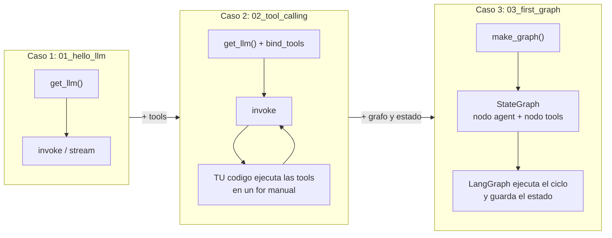
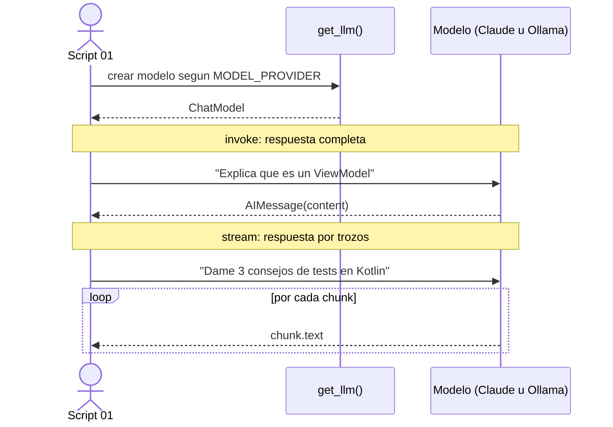
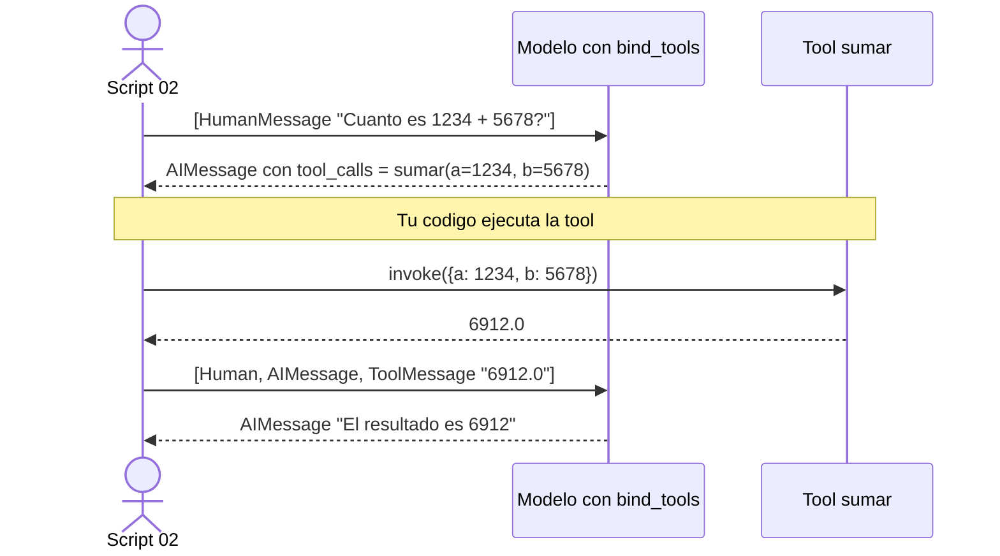
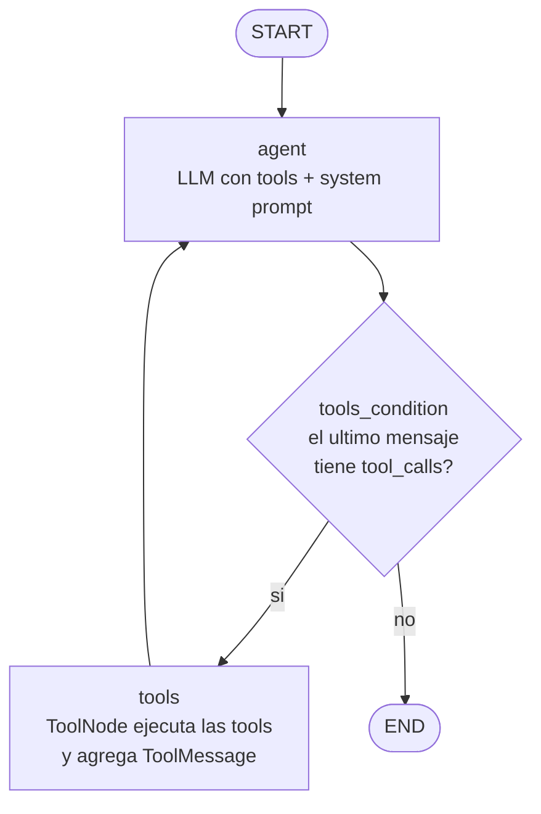
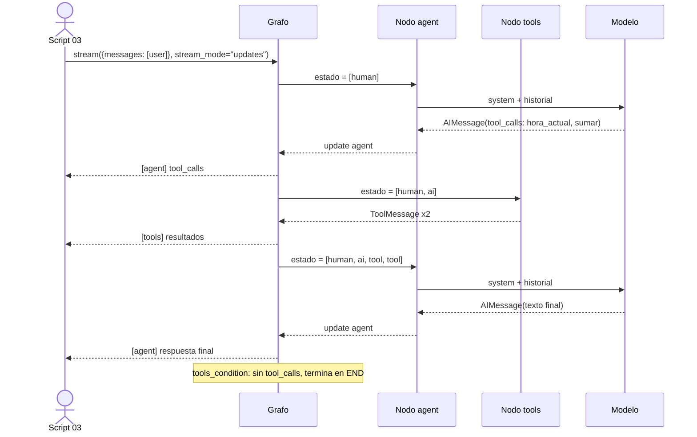
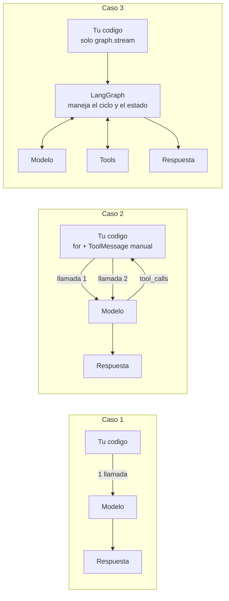
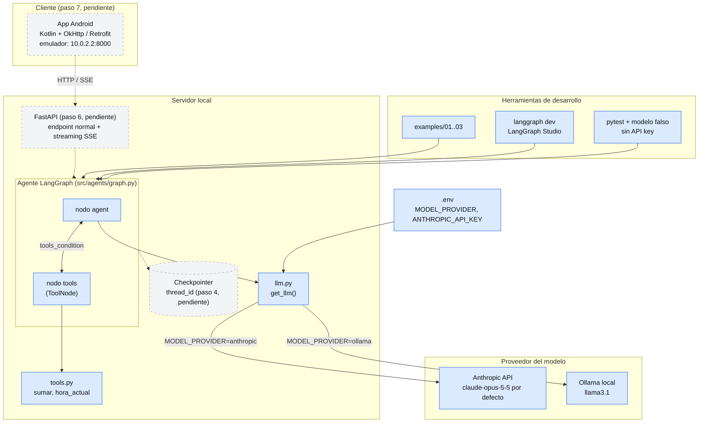
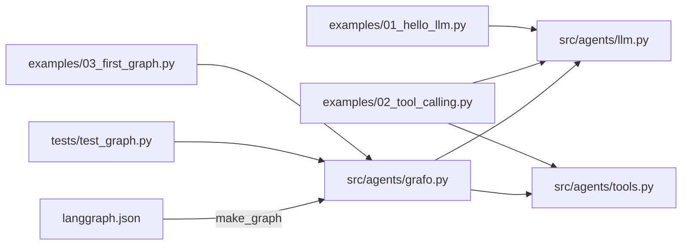

# Diagramas

Todos los diagramas usan Mermaid y se ven directamente en GitHub.

Contenido:

1. [Los tres casos en una mirada](#1-los-tres-casos-en-una-mirada)
2. [Caso 1: Hello LLM](#2-caso-1-hello-llm)
3. [Caso 2: Tool calling manual](#3-caso-2-tool-calling-manual)
4. [Caso 3: Primer grafo](#4-caso-3-primer-grafo)
5. [Comparación: quién controla el ciclo](#5-comparación-quién-controla-el-ciclo)
6. [Arquitectura general](#6-arquitectura-general)
7. [Dependencias entre módulos del repo](#7-dependencias-entre-módulos-del-repo)

---

## 1. Los tres casos en una mirada

Cada caso agrega una capa sobre el anterior.

| | Caso 1 | Caso 2 | Caso 3 |
|---|---|---|---|
| Archivo | `examples/01_hello_llm.py` | `examples/02_tool_calling.py` | `examples/03_first_graph.py` |
| Llamadas al LLM | 1 | 2 (o más si el modelo encadena tools) | Las que haga falta, el grafo repite el ciclo |
| Usa tools | No | Sí, ejecutadas a mano | Sí, ejecutadas por `ToolNode` |
| Quién decide si seguir | Nadie, es una sola llamada | Tu código (`for` sobre `tool_calls`) | La arista condicional `tools_condition` |
| Historial de mensajes | No existe | Lista que armas y mantienes tú | `MessagesState` administrado por el grafo |
| Código de control propio | Ninguno | Alto | Bajo, se declara el grafo |
| Qué se aprende | Cómo hablar con el modelo | El modelo pide tools, no las ejecuta | Nodos, estado y aristas condicionales |

**Parecido entre los tres:** usan `get_llm()`, el mismo modelo y los mismos mensajes (`HumanMessage`, `AIMessage`).
**Diferencia clave:** a quién le toca el ciclo "modelo, tool, modelo".

---

## 2. Caso 1: Hello LLM

Una sola pregunta, una sola respuesta. Sin tools ni estado.

---

## 3. Caso 2: Tool calling manual

El modelo **pide** una tool, pero **no la ejecuta**. Tu código hace de intermediario.

Si el modelo necesitara otra tool después, este script no lo maneja: haría falta repetir el ciclo a mano. Eso es lo que resuelve el caso 3.

---

## 4. Caso 3: Primer grafo

El ciclo lo maneja LangGraph. Esta es la forma del grafo definido en `src/agents/graph.py`.

Cómo cambia el estado (`MessagesState`) en una ejecución típica:

---

## 5. Comparación: quién controla el ciclo

Analogía Android:

| Caso | Equivalente |
|---|---|
| 1 | Una llamada Retrofit suelta |
| 2 | Un ViewModel donde tú mismo orquestas varias llamadas con `if` y `while` |
| 3 | Una máquina de estados declarativa con `UiState` y transiciones |

---

## 6. Arquitectura general

Lo que ya existe está en azul. Lo planificado (pasos 4 a 7 de la ruta) va punteado.

Puntos de seguridad y red:

- La API key del LLM vive solo en el servidor (`.env`). La app Android nunca la ve.
- El emulador llega a tu máquina por `10.0.2.2`. En un dispositivo físico se usa la IP de la red local.
- HTTP sin TLS requiere un `network_security_config` solo en el build debug.

---

## 7. Dependencias entre módulos del repo

El caso 3 usa `make_graph()` (con el modelo real) y el test usa `build_graph(llm)` con un modelo falso. Por eso `graph.py` separa las dos funciones.
